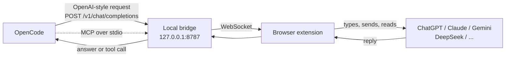

<div align="center">


# NOAPI?

**Use ChatGPT, Claude, Gemini, DeepSeek and friends inside [OpenCode](https://opencode.ai), with no API keys.**

Your browser is already logged in. NOAPI? just lets OpenCode talk to it.

<br>


<br>

[Quick start](#-quick-start) &nbsp;•&nbsp;
[How it works](#-how-it-works) &nbsp;•&nbsp;
[Any project folder](#-use-it-from-any-project-folder) &nbsp;•&nbsp;
[Troubleshooting](#-troubleshooting) &nbsp;•&nbsp;
[Limitations](#-honest-limitations)

</div>

<br>

## 💡 Why this exists

API access costs money, and a lot of us already pay for a chat subscription that we barely squeeze the value out of. NOAPI? connects the two. OpenCode sends a prompt, a small browser extension types it into the real chat page you have open, waits for the answer, and hands it back.

It is not magic and it is not an official integration. It is a careful bit of plumbing that works well enough that you can run a real coding agent on top of it, including file edits and shell commands.

<br>

## ✨ What you get

<table>
  <tr>
    <td width="50%" valign="top">

**🧰 Real tool use**<br>
`bash`, `read`, `write`, `edit` and the rest of OpenCode's tools work. The bridge teaches the website model a tiny text protocol and turns its replies into proper tool calls.

  </td>
    <td width="50%" valign="top">

**🧠 Live "Thinking" status**<br>
While the site works, OpenCode shows what is going on: typing, sending, waiting, answering. No more staring at a blank screen.

  </td>
  </tr>
  <tr>
    <td valign="top">

**🤖 Fully automatic**<br>
No copy and paste, no confirm button. Prompts are typed, sent and captured on their own. Only the assistant's reply goes back, not the whole page.

  </td>
    <td valign="top">

**🔌 Two ways to use it**<br>
Pick a browser model straight from `/models`, or keep your favourite model and let it ask a website through the MCP tool.

  </td>
  </tr>
  <tr>
    <td valign="top">

**🪶 Zero dependencies**<br>
The bridge is plain Node.js 18+. No `npm install`, no build step, nothing to audit except the code in this repo.

  </td>
    <td valign="top">

**🔒 Local only**<br>
Everything stays on `127.0.0.1`. No telemetry, no proxy, no third party servers. It runs in your own logged in session.

  </td>
  </tr>
</table>

<br>

## 🌐 Supported sites

| | Site | Model id in OpenCode | Address |
|:-:|---|---|---|
| <picture><source media="(prefers-color-scheme: dark)" srcset="https://cdn.simpleicons.org/openai/white"></picture> | **ChatGPT** | `noapi/chatgpt` | chatgpt.com |
| <picture><source media="(prefers-color-scheme: dark)" srcset="https://cdn.simpleicons.org/claude/white"></picture> | **Claude** | `noapi/claude` | claude.ai |
| <picture><source media="(prefers-color-scheme: dark)" srcset="https://cdn.simpleicons.org/googlegemini/white"></picture> | **Gemini** | `noapi/gemini` | gemini.google.com |
| <picture><source media="(prefers-color-scheme: dark)" srcset="https://cdn.simpleicons.org/deepseek/white"></picture> | **DeepSeek** | `noapi/deepseek` | chat.deepseek.com |
| <picture><source media="(prefers-color-scheme: dark)" srcset="https://cdn.simpleicons.org/perplexity/white"></picture> | **Perplexity** | `noapi/perplexity` | perplexity.ai |
| <picture><source media="(prefers-color-scheme: dark)" srcset="https://cdn.simpleicons.org/xai/white"></picture> | **Grok** | `noapi/grok` | grok.com |
| <picture><source media="(prefers-color-scheme: dark)" srcset="https://cdn.simpleicons.org/mistralai/white"></picture> | **Mistral** | `noapi/mistral` | chat.mistral.ai |

You need to be logged in, and the site has to be open in a tab. If you open several, each one can serve its own model.

<br>

## 🚀 Quick start

**You need:** Node.js 18 or newer, Chrome (or Edge, Brave, Opera, Arc) or Firefox, and OpenCode.

### 1️⃣ Load the extension

<details open>
<summary><b>Chrome, Edge, Brave, Opera, Arc</b></summary>

1. Open `chrome://extensions`
2. Turn on **Developer mode** (top right)
3. Click **Load unpacked**
4. Pick the `extension/chrome` folder

</details>

<details>
<summary><b>Firefox</b></summary>

1. Open `about:debugging#/runtime/this-firefox`
2. Click **Load Temporary Add-on...**
3. Pick `extension/firefox/manifest.json`

Firefox forgets temporary add-ons when it closes, so you will repeat this after a restart.

</details>

### 2️⃣ Start the bridge

```bash
npm start
```

Leave it running. You can peek at the dashboard any time at **http://127.0.0.1:8787/**.

### 3️⃣ Open an AI site

Open one of the [supported sites](#-supported-sites) and log in. You will see a small round **`?`** button in the bottom right corner.

| Dot color | Meaning |
|:-:|---|
| 🟢 | Connected to the bridge, ready |
| 🟡 | Busy, a prompt is being handled |
| 🔴 | The bridge is not running |

### 4️⃣ Use it in OpenCode

Run `opencode` inside this folder, type `/models`, search for **NOAPI?** and pick something like `noapi/chatgpt`. Then just work as usual.

> 💬 Try: *"make a folder named test and put a hello.txt inside it"*. If everything is wired up, you will see the status lines scroll by and the files show up on disk.

<br>

## 📁 Use it from any project folder

The `opencode.json` in this repo only applies when you launch OpenCode from this exact folder. To use NOAPI? in all your projects, register it once in your global OpenCode config:

```bash
npm run install-global
```

That adds the `noapi` provider and the MCP server to `~/.config/opencode/opencode.json`, using the absolute path of this folder. Your other settings are kept, and a backup is saved next to the file as `opencode.json.bak`.

Then, for each project:

```bash
# terminal 1, inside the NOAPI? folder
npm start

# terminal 2, inside your project
opencode
```

A few things worth knowing:

- Start the bridge **before** OpenCode. If OpenCode has to start it for you and you close that session, other sessions lose the model.
- If you move the NOAPI? folder, run `npm run install-global` again.
- To undo it, run `npm run install-global -- --remove`.

<br>

## 🧩 How it works



In plain words:

1. OpenCode thinks it is talking to an OpenAI compatible server. That server is the **bridge**, a tiny Node program on your machine.
2. The bridge forwards the prompt over a WebSocket to the **extension**.
3. The extension finds the chat box on the open tab, types the prompt, presses send, and watches the page until the answer is complete.
4. The answer travels back the same way.

### 🧰 How tools work on a website that has no tools

Chat websites do not accept tool definitions, so the bridge improvises:

1. On the first prompt of a conversation it adds a short briefing that lists the available tools and a simple format for calling them.
2. When the model wants to act, it writes a fenced block starting with `TOOL_CALL`, followed by a small JSON object.
3. The bridge cuts that block out of the reply and hands OpenCode a real `tool_calls` response.
4. OpenCode runs the tool and sends the result back, which the bridge pastes into the chat as the next message.

Because the website already remembers the conversation, only the **new** message is sent each turn, not the whole history. Very long tool output is trimmed in the middle to keep prompts sane.

### 🛡️ Small details that make it nicer

- 🚦 Requests to the same site are queued, so two prompts never collide in one chat box.
- ⏹️ Press <kbd>Esc</kbd> in OpenCode and the extension also hits the stop button on the website.
- 🏷️ OpenCode's session title requests are answered locally, so they do not clutter your real chat.
- 🔁 If a site swallows a send, or wipes the text you just typed, the extension notices and tries again.

<br>

## ⚙️ Configuration

<details>
<summary><b>Manual setup in <code>opencode.json</code></b></summary>

If you prefer to edit the config by hand, this is what `npm run install-global` writes (replace the path with your own):

```json
{
  "$schema": "https://opencode.ai/config.json",
  "provider": {
    "noapi": {
      "npm": "@ai-sdk/openai-compatible",
      "name": "NOAPI? (browser bridge)",
      "options": {
        "baseURL": "http://127.0.0.1:8787/v1",
        "apiKey": "noapi-local"
      },
      "models": {
        "chatgpt":    { "name": "ChatGPT via browser",    "limit": { "context": 128000,  "output": 8192 } },
        "claude":     { "name": "Claude via browser",     "limit": { "context": 200000,  "output": 8192 } },
        "gemini":     { "name": "Gemini via browser",     "limit": { "context": 1000000, "output": 8192 } },
        "deepseek":   { "name": "DeepSeek via browser",   "limit": { "context": 128000,  "output": 8192 } },
        "perplexity": { "name": "Perplexity via browser", "limit": { "context": 100000,  "output": 8192 } },
        "grok":       { "name": "Grok via browser",       "limit": { "context": 128000,  "output": 8192 } },
        "mistral":    { "name": "Mistral via browser",    "limit": { "context": 128000,  "output": 8192 } }
      }
    }
  },
  "mcp": {
    "noapi": {
      "type": "local",
      "command": ["node", "/absolute/path/to/NOAPI/bridge/index.js", "--mcp"],
      "enabled": true,
      "timeout": 30000
    }
  }
}
```

The API key is a dummy value. Nothing checks it.

</details>

<details>
<summary><b>Bridge flags and endpoints</b></summary>

```bash
node bridge/index.js [--mcp] [--port=8787] [--host=127.0.0.1]
```

| Flag | What it does |
|---|---|
| `--port=8788` | Use another port. Update `baseURL` in your config to match. |
| `--host=...` | Bind address. Keep it on `127.0.0.1` unless you know why you are changing it. |
| `--mcp` | Also expose the MCP server on stdio. If the port is already taken by a running bridge, it switches to proxy mode and forwards to it. |

| Endpoint | Purpose |
|---|---|
| `GET /` | Status dashboard |
| `GET /health` | JSON status: clients, pending requests, sites |
| `GET /v1/models` | One model per site |
| `POST /v1/chat/completions` | OpenAI compatible chat, streaming and non streaming |

The MCP server offers three tools: `chat` (ask a site), `status` and `sites`.

</details>

<br>

## 🔧 Troubleshooting

| What you see | What to try |
|---|---|
| **"No browser tab on ... is connected"** | Open that site in a tab, make sure you are logged in, and check that the `?` button has a green dot. Refresh the tab if the extension was just reloaded. |
| **Red dot on the `?` button** | The bridge is not running. Start it with `npm start`. |
| **Port 8787 already in use** | Run `node bridge/index.js --port=8788` and change `baseURL` in your config to `:8788/v1`. |
| **NOAPI? is missing from `/models`** | You are probably outside this folder. Run `npm run install-global` once. |
| **Stuck at "Waiting for ... to answer"** | The site may have changed its layout. Open the `?` panel and read the last status line. The stall message includes a short technical summary you can paste into an issue. |
| **The prompt gets typed but never sent** | The extension retries a few times on its own. If it keeps failing, the send button selector for that site probably needs an update. |
| **It worked yesterday, today it does not** | Sites change their pages. See [Limitations](#-honest-limitations) and [Adding or fixing a site](#-adding-or-fixing-a-site). |
| **Firefox lost the extension** | Temporary add-ons disappear on restart. Load it again from `about:debugging`. |

> 🪪 **Tip:** keep the AI tab visible when you can. Browsers slow down background tabs, which can make long responses laggy.

<br>

## 🧪 Testing without a browser

You can check the whole pipeline with a fake browser tab. No real site needed.

```bash
npm test
```

This starts a bridge, connects a fake extension, and runs plain requests, streaming, MCP in both modes, and a full tool call round trip (model asks for `bash`, gets the result, answers).

<br>

## 🗂️ Project layout

```text
NOAPI/
├── bridge/                 Local server (pure Node.js)
│   ├── index.js            Entry point, WebSocket + HTTP + MCP wiring
│   ├── http.js             OpenAI compatible endpoints and dashboard
│   ├── state.js            Request queue, routing, progress, cancel
│   ├── toolproto.js        TOOL_CALL protocol: prompt building and parsing
│   ├── mcp.js              MCP server over stdio (with proxy mode)
│   ├── ws.js / wsclient.js Minimal WebSocket server and client
│   └── sites.js            Supported sites
├── extension/
│   ├── chrome/             Manifest V3 extension
│   └── firefox/            Same code, Firefox manifest
├── tools/
│   ├── install-global.js   Register NOAPI? in your global OpenCode config
│   ├── fake-extension.js   Fake browser tab for tests
│   ├── test-all.js         End to end tests
│   └── test-tools.js       Tool call round trip test
└── opencode.json           Project level OpenCode config
```

<br>

## 🤝 Adding or fixing a site

Sites change their HTML from time to time, so selectors rot. The good news is that each site is only a small block of config.

1. In `extension/chrome/content.js`, find the `SITES` object. Each entry lists CSS selectors for the **input**, the **send** button, the **stop** button and the **reply** messages.
2. Open the site, right click the element, choose Inspect, and update the selector.
3. Copy the same file to `extension/firefox/content.js` so both browsers match.
4. For a brand new site, also add it to `bridge/sites.js`, to `opencode.json`, and to the `matches` and `host_permissions` in both manifests.
5. Run `npm test`, reload the extension, and try it on the real page.

Pull requests with selector fixes are very welcome. 🙏

<br>

## ⚠️ Honest limitations

I would rather tell you now than have you find out later.

- **It depends on page layouts.** There is no official interface here. When a site redesigns its chat page, that site can break until the selectors are updated.
- **Speed.** You are driving a real web page, so replies take as long as the website takes, plus a little overhead.
- **Tool quality varies by model.** Tool use works through a text format the model has to follow. Strong models do it reliably, weaker ones occasionally slip.
- **One conversation per site tab.** The website keeps the history, so a very long session may hit that site's own limits.
- **Free plans have limits too.** The websites still apply their own message caps and rules.
- **Terms of service.** Automating a website may go against that site's terms. This project is meant for personal use with your own account. You are responsible for how you use it, and it is not affiliated with OpenAI, Anthropic, Google, DeepSeek, Perplexity, xAI, Mistral or OpenCode.

<br>

## 🔐 Privacy and security

- 🏠 The bridge listens on `127.0.0.1` only. Nothing is exposed to your network.
- 🚫 No analytics, no tracking, no external servers.
- 🍪 The extension never reads or stores your passwords or cookies. It only types into and reads from the chat page you already opened.
- 👀 It is plain JavaScript with no build step, so what you read is what runs.

<br>

## 📄 License

NOAPI? is released under the [MIT License](LICENSE). Use it, change it, share it. Just keep the license notice.

<br>

<div align="center">

Made for people who like their tools local and their bills small. 💚

If NOAPI? saved you some money, a ⭐ on the repo is a nice way to say thanks.

</div>
